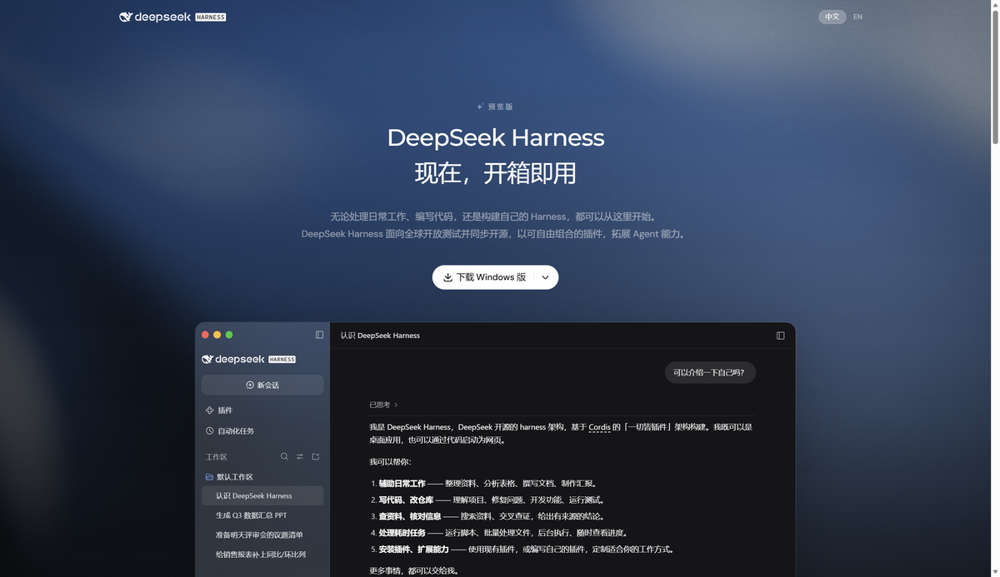

# Browser Bridge

**Let an AI agent drive the Edge/Chrome you are actually using** — same tab, same cookies, same logins. No `--remote-debugging-port`, no separate profile, no "restart your browser" step.

> This is the same model WorkBuddy / CodeBuddy use for browser control: a browser extension is the bridge, not the DevTools protocol.

📖 中文说明见下方。



---

## Why not just use CDP?

`--remote-debugging-port` only works on an instance that was **launched with that flag**. Your everyday browser has no such entry point, and restarting it with the flag would lose your session (and on Windows, your running profile is locked anyway).

An extension, on the other hand, can inject scripts into tabs that are already open. That is the only non-intrusive entry point. Everything here is built on it:

```
agent / CLI ──HTTP──> bridge server (127.0.0.1:7233) <──long-poll── extension ──chrome.scripting──> page
```

The bridge server is a dumb relay: it queues a command, an extension long-poll picks it up, executes it, and posts back the result. No WebSocket library, no dependencies.

## Quick start

Requirements: **Node 18+**, Microsoft Edge or any Chromium browser that supports MV3.

```bash
# 1. start the bridge (keep the window open)
node server.mjs          # or double-click start-bridge.cmd on Windows

# 2. load the extension
#    edge://extensions  -> enable "Developer mode" -> "Load unpacked" -> pick ./extension

# 3. verify
node cli.mjs status
```

`status` should print `扩展连接: 在线` (extension online).

## Security model

The extension has `scripting` + `<all_urls>` (script injection needs it) and **does not** request `tabs`.

- **Only shared tabs are ever scripted.** Everything else is unreachable — not just hidden in the UI, but rejected by the service worker (`requireShared`).
- A tab becomes shared when:
  - the agent opens it (`cli open <url>`), or
  - you click **共享当前标签页** in the extension popup, or
  - it was opened from an already-shared tab (`target=_blank` / `window.open`) — so clicking a search result keeps working.
- The popup has a one-click **全部取消** kill switch. Badge counter = number of shared tabs.
- Nothing is written to disk except a local tab id in `.state.json`.

## CLI

```bash
node cli.mjs status                       # bridge + extension health
node cli.mjs tabs                         # list tabs (unshared ones show id only)
node cli.mjs open https://example.com     # open + share + make current
node cli.mjs share | unshare [tabId]
node cli.mjs close [tabId]

node cli.mjs snap [--max 150] [--no-text] # snapshot: interactive elements + page text
node cli.mjs click e3                     # by ref
node cli.mjs click "text=Sign in"         # by visible text
node cli.mjs click "css=#submit"          # by selector
node cli.mjs fill e1 "query"              # set value (native setter, React/Vue safe)
node cli.mjs type e1 "typed"              # per-character key events
node cli.mjs press Enter
node cli.mjs select e2 "Option text"
node cli.mjs scroll --to bottom
node cli.mjs text --limit 3000
node cli.mjs eval "document.title"
node cli.mjs wait --spec ".results"
node cli.mjs shot page.png                # -> shots/page.png

node cli.mjs goto <url> | back | forward | reload
```

`--tab <id>` targets a specific tab; otherwise the last touched one is used.

### How refs work

`snap` walks the DOM, tags visible interactive elements with `data-dsh-ref="e1|e2|…"` **in DOM order**, and prints them. `click`/`fill` resolve a ref back to that element.

Refs are positional, so **take a fresh snapshot before acting** when the page has changed. The CLI prints what it clicked, so a mismatch is visible immediately.

## Design notes

| Decision | Why |
|---|---|
| HTTP long-poll instead of WebSocket | Node has no built-in WS *server*; long-poll is ~100 lines of plain `http` and needs zero dependencies |
| Offscreen document holds the connection | MV3 service workers are killed after ~30s idle; an offscreen document is not |
| `chrome.storage.local` for the shared list | survives extension reloads; stale tab ids simply stop matching after a browser restart |
| One injected `pageAgent()` function for all page ops | `chrome.scripting.executeScript` serializes the function, so everything must be self-contained — a single dispatcher avoids duplicating helpers |
| `fill` uses the native value setter + `input`/`change` | frameworks that track the value setter (React) otherwise ignore the assignment |

## Known limitations

- Cannot touch `edge://` pages, the Edge Add-ons store, the PDF viewer, or other browser-internal pages (injection is blocked there).
- File inputs (`<input type=file>`) cannot be filled — browsers require a real user gesture.
- Screenshots use `captureVisibleTab`: viewport only, and a background tab is brought to the front first.
- `press Enter` dispatches a JS keyboard event; it will not submit a form by itself. Click the submit button instead.
- `eval` runs in the extension's isolated world: full DOM access, but no access to the page's own `window.*` variables.
- Single browser at a time (the last extension to connect wins).

## Troubleshooting

| Symptom | Fix |
|---|---|
| `扩展未连接` (extension offline) | is the bridge window still running? is the extension enabled? |
| `标签页 N 没有被共享` | share it from the popup, or use `open` |
| `No current window` | no browser window exists; `open` creates one |
| Port already in use | `node server.mjs` with `BRIDGE_PORT=7344`, then change the port in `extension/offscreen.js` |
| Extension errors after an update | `edge://extensions` → reload; make sure `chrome.storage` is never used from the offscreen document (only `chrome.runtime` exists there) |

> **Edge tip:** if Edge offers "关闭开发人员模式?" (turn off developer mode), choose **以后再说 / Not now**. Unpacked extensions require developer mode, and turning it off disables the bridge.

## 中文说明

**它是什么**：让 AI 代理直接操作你正在用的 Edge/Chrome——同一个标签页、同一份登录态，不用加调试端口、不用另开配置目录。

**为什么不用 CDP**：`--remote-debugging-port` 只对「带这个参数启动」的实例生效；你日常的浏览器没有这个入口，而且 Windows 下正在使用的配置目录是被锁住的。扩展可以对已打开的标签页注入脚本，这是唯一不打扰用户的接入点。

**三步跑起来**

1. `node server.mjs`（Windows 上双击 `start-bridge.cmd`），窗口保持开着
2. `edge://extensions` → 打开「开发人员模式」→「加载解压缩的扩展」→ 选 `extension/`
3. `node cli.mjs status`，看到「扩展连接: 在线」就成了

**安全边界**：扩展只对**已共享**的标签页注入脚本，其余页面它在代码层直接拒绝，不是靠界面藏起来。共享来源有三种：代理用 `open` 打开的、你在弹窗里点「共享当前标签页」的、以及从共享页里点出来的新标签页。弹窗里「全部取消」随时收回。

**常用命令**

```bash
node cli.mjs open https://example.com   # 新开并共享
node cli.mjs snap                        # 抓可交互元素（e1/e2…）与正文
node cli.mjs click e3                    # 按 ref 点
node cli.mjs fill e1 "关键词"             # 填值（兼容 React/Vue）
node cli.mjs press Enter
node cli.mjs shot page.png               # 截图
```

**几个坑**（都已在代码里处理，改代码时注意别踩回去）

- offscreen 文档只有 `chrome.runtime`，拿不到 `chrome.storage`，端口只能写死或用 URL 参数传
- MV3 服务工作线程约 30 秒空闲就被回收，长连接必须挂在 offscreen 文档上
- Node 的 `req.on('close')` 对无 body 的 GET 会立刻触发，长轮询挂起项不能用它清理
- `click` 必须检测新标签页（`target=_blank`），否则点了搜索结果等于没点

## License


MIT
